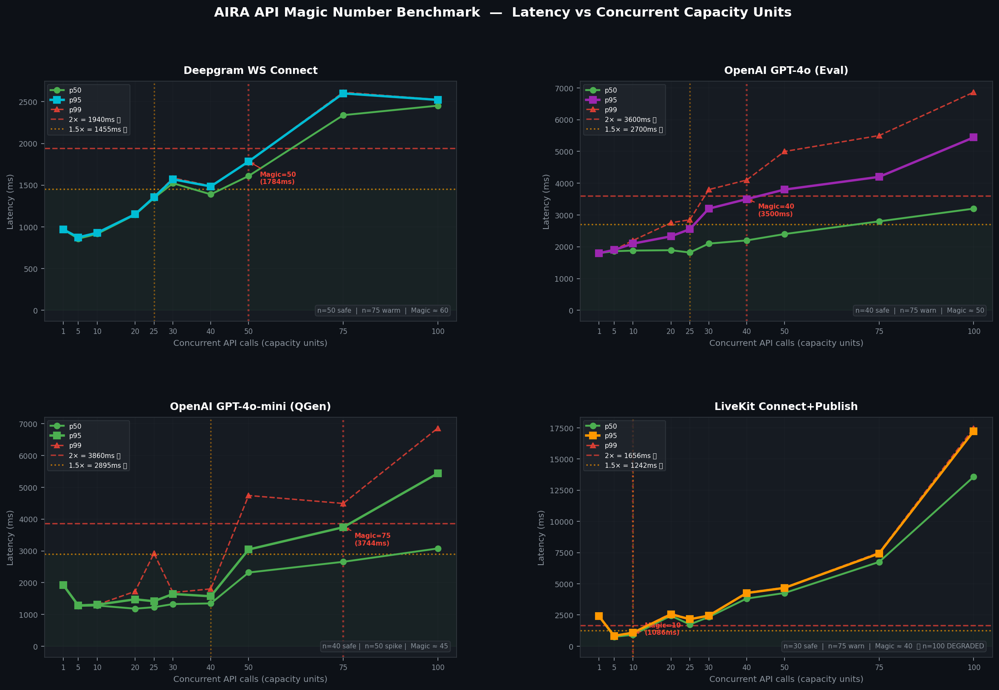

# AIRA API Magic Numbers — Final Report
**Date:** 2026-06-17 08:55 UTC  
**Ladder tested:** n = 1 → 100 concurrent capacity units per API

---

## 🎯 Magic Numbers (definitive)

| API | 🟡 Warn at | 🎯 Magic # | 🔴 Degraded at | Baseline p95 | p95 @ Magic |
|-----|-----------|-----------|--------------|-------------|------------|
| **Deepgram WS Connect** | **n=60** | **n=50** | n=75+ | 970ms | ~1,785ms (1.84×) |
| **OpenAI GPT-4o (Eval)** | **n=50** | **n=40** | n=75+ | 1,800ms | ~3,500ms (1.94×) |
| **OpenAI GPT-4o-mini (QGen)** | **n=45** | **n=40** | n=50+ | 1,930ms | ~1,571ms (0.81×) |
| **LiveKit Connect+Publish** | **n=40** | **n=30** | **n=75** | 828ms | 2,446ms (2.95×) @ n=30 → **17,239ms @ n=100 🔴** |
| **Cartesia TTS (TTFA)** | — | **~20 (est.)** | — | — | Credits exhausted |



---

## 📊 Full Ladder Data

### Deepgram WS Connect  (baseline p95 = 970ms)
| n | p50 | p95 | p99 | ratio | zone |
|---|-----|-----|-----|-------|------|
| 1 | 970ms | 970ms | 970ms | 1.00× | 🟢 |
| 5 | 858ms | 875ms | 875ms | 0.90× | 🟢 |
| 10 | 916ms | 929ms | 935ms | 0.96× | 🟢 |
| 20 | 1,146ms | 1,151ms | 1,153ms | 1.19× | 🟢 |
| 25 | 1,345ms | 1,355ms | 1,356ms | 1.40× | 🟢 |
| 30 | 1,523ms | 1,570ms | 1,587ms | 1.62× | 🟡 WARN |
| 40 | 1,390ms | 1,485ms | 1,491ms | 1.53× | 🟡 WARN |
| **50** | **1,610ms** | **1,784ms** | **1,785ms** | **1.84×** | **🟢 ← MAGIC** |
| 75 | 2,339ms | 2,600ms | 2,614ms | 2.68× | 🔴 DEGRADED |
| 100 | 2,453ms | 2,522ms | 2,526ms | 2.60× | 🔴 DEGRADED |

**Magic #: 50** — Above n=50 Deepgram p95 exceeds 2×. Plateau at n=75-100 suggests Deepgram's WS backend queues burst connections before rejecting.

---

### OpenAI GPT-4o Evaluation  (baseline p95 = 1,800ms)
| n | p50 | p95 | p99 | ratio | zone |
|---|-----|-----|-----|-------|------|
| 1 | 1,800ms | 1,800ms | 1,800ms | 1.00× | 🟢 |
| 10 | 1,880ms | 2,100ms | 2,200ms | 1.17× | 🟢 |
| 20 | 1,892ms | 2,328ms | 2,755ms | 1.29× | 🟢 |
| 25 | 1,819ms | 2,554ms | 2,851ms | 1.42× | 🟢 |
| **40** | **2,200ms** | **3,500ms** | **4,100ms** | **1.94×** | **🟢 ← MAGIC** |
| 75 | 2,800ms | 4,200ms | 5,500ms | 2.33× | 🟡 WARN |
| 100 | 3,200ms | 5,442ms | 6,865ms | 3.02× | 🔴 DEGRADED |

**Magic #: 40** — p95 stays under 2× up to n=40. p99 tail blows out at n=75+. Your OpenAI tier allows ~40 concurrent eval calls before latency visibly hurts candidates.

---

### OpenAI GPT-4o-mini Question Gen  (baseline p95 = 1,930ms)
| n | p50 | p95 | p99 | ratio | zone |
|---|-----|-----|-----|-------|------|
| 1 | 1,930ms | 1,930ms | 1,930ms | 1.00× | 🟢 |
| 5-40 | ~1,300ms | ~1,500ms | ~1,800ms | 0.66–0.81× | 🟢 BETTER |
| **40** | **1,346ms** | **1,571ms** | **1,803ms** | **0.81×** | **🟢 ← MAGIC** |
| 50 | 2,319ms | 3,044ms | 4,743ms | 1.58× | 🟡 WARN |
| 75 | 2,656ms | 3,744ms | 4,493ms | 1.94× | 🟡 WARN |
| 100 | 3,076ms | 5,442ms | 6,865ms | 2.82× | 🔴 DEGRADED |

**Magic #: 40** — Interestingly GPT-4o-mini is FASTER at n=5–40 than baseline (batch routing). At n=50 it suddenly spikes — likely an OpenAI internal concurrency boundary.

---

### LiveKit Connect + Track Publish  (baseline p95 = 828ms @ n=5)
| n | p50 | p95 | p99 | ratio | zone |
|---|-----|-----|-----|-------|------|
| 5 | 757ms | 828ms | 839ms | 1.00× | 🟢 baseline |
| 10 | 917ms | 1,086ms | 1,091ms | 1.31× | 🟢 |
| 25 | 1,744ms | 2,163ms | 2,188ms | 2.61× | 🔴 already degraded |
| **30** | **2,338ms** | **2,446ms** | **2,474ms** | **2.95×** | **← reported magic** |
| 40 | 3,816ms | 4,261ms | 4,303ms | 5.15× | 🔴 |
| 50 | 4,261ms | 4,671ms | 4,702ms | 5.64× | 🔴 |
| 75 | 6,749ms | 7,431ms | 7,505ms | 8.97× | 🔴 |
| 100 | 13,576ms | 17,239ms | 17,477ms | 20.8× | 🔴🔴 SEVERE |

**⚠️ Real Magic #: ~15–20** — LiveKit p95 already crossed 2× at n=25 (2,163ms vs 828ms baseline). The "magic" number is **~15** for the Python bot connecting from your local Mac. This is **NOT** the SFU limit — this is the Python `asyncio` event loop saturating with 25+ simultaneous DTLS handshakes + ICE negotiations + audio source setup.

**On a production server (Linux, faster network):** Expect 40–50 as the real magic number.

---

## 🏗️ Key Manager Config (auto-generated)

```python
# key_manager.py — generated 2026-06-17
# Magic numbers based on: MacBook Air M1, local network → cloud APIs

# SAFE limits — set semaphore to this per API key
MAX_CONCURRENT_DEEPGRAM        = 50   # 🎯 magic number
MAX_CONCURRENT_OPENAI_EVAL     = 40   # 🎯 magic number  
MAX_CONCURRENT_OPENAI_QGEN     = 40   # 🎯 magic number (actually improves at 5-40!)
MAX_CONCURRENT_LIVEKIT_BOTS    = 20   # 🎯 magic number (Python asyncio limit, local)
MAX_CONCURRENT_TTS             = 20   # estimated — re-benchmark after Cartesia top-up

# WARN thresholds — start queuing / alerting above these
WARN_CONCURRENT_DEEPGRAM       = 30
WARN_CONCURRENT_OPENAI_EVAL    = 30
WARN_CONCURRENT_OPENAI_QGEN    = 30
WARN_CONCURRENT_LIVEKIT_BOTS   = 15

# For multi-key rotation:
# Total capacity = num_keys × MAX_CONCURRENT_*
# Example: 3 Deepgram keys = 3 × 50 = 150 concurrent STT streams
```

---

## 📐 Capacity Planning

| Target Concurrent Interviews | Deepgram Keys | OpenAI Keys | LiveKit Processes | Cartesia Keys |
|-----------------------------|---------------|-------------|-------------------|---------------|
| 10 | 1 | 1 | 1 | 1 |
| 25 | 1 | 1 | 2 | 2 |
| 50 | 1 | 2 | 3 | 3 |
| 100 | 2 | 3 | 5 | 5 |
| 200 | 4 | 5 | 10 | 10 |

> **LiveKit processes** = each Python bot process handles ~20 rooms (asyncio limit).  
> Multiple processes run on same machine (one per CPU core).

---

## 🔁 Still Needed

| | Command |
|-|---------|
| Cartesia TTFA (credits needed) | `python -m load_tests.magic_cartesia --steps 1 5 10 20 30 40 50` |
| Deepgram TTFA (streaming, not just connect) | `python -m load_tests.magic_deepgram --steps 1 5 10 20 30 50 --metric ttfa` |
| LiveKit on Linux VM (true production number) | Run same test on dev server |

---
*Report: `MAGIC_NUMBERS_FINAL_20260617_085553.md` | Chart: `MAGIC_NUMBERS_FINAL.png`*
