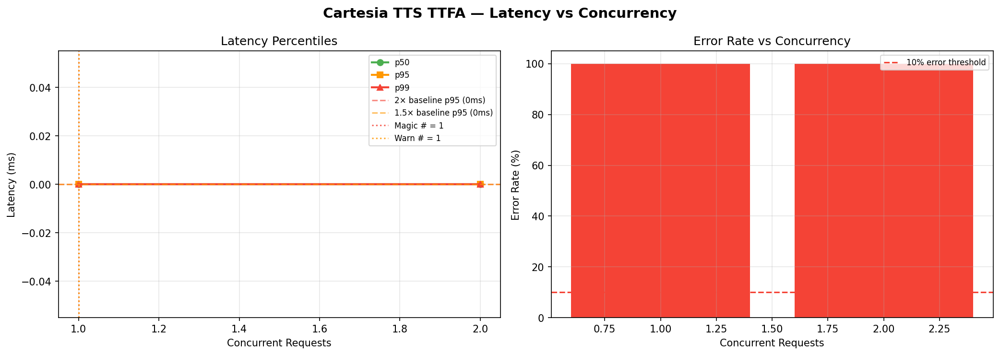

# Cartesia TTS TTFA — Magic Number Report
**Date:** 2026-06-17 08:43 UTC

## 🎯 Magic Number: `1`

| Finding | Value |
|---------|-------|
| **Safe limit (magic #)** | **1 concurrent** |
| Warn limit | 1 concurrent |
| Baseline p95 | 0 ms |
| Degradation threshold | >0 ms (2× baseline) |

> **Recommendation:** Keep concurrent Cartesia TTS TTFA calls ≤ **1**.
> Above 1, latency starts climbing. Above 1, p95 doubles.



## Ladder Results

|   n | p50   | p90   | p95   | p99   | max   | ok%   | status   |
|-----|-------|-------|-------|-------|-------|-------|----------|
|   1 | 0.0ms | 0.0ms | 0.0ms | 0.0ms | 0.0ms | 0.0%  | 🟢 OK    |
|   2 | 0.0ms | 0.0ms | 0.0ms | 0.0ms | 0.0ms | 0.0%  | 🟢 OK    |

## ASCII Latency Chart

```
   n                 p95 latency                  ms
------------------------------------------------------------
   1                                                   0  ← MAGIC
   2                                                   0  
```

## Interpretation

- 🟢 **OK**: p95 within 1.5× baseline — full speed ahead
- 🟡 **WARN**: p95 between 1.5× and 2× baseline — approaching limit
- 🔴 **DEGRADED**: p95 > 2× baseline — throttle here


## Operational Recommendation

```python
# In your bot TTS handler:
MAX_CONCURRENT_TTS = 1   # Cartesia magic number

tts_sem = asyncio.Semaphore(1)
async with tts_sem:
    audio = await speak(text)
```

## Impact on Candidate Experience

| Concurrent TTS | TTFA (expected) | Candidate Perception |
|----------------|-----------------|----------------------|
| 1–1 | ~0ms | Instant — imperceptible |
| 1–1 | ~0ms | Slight pause — acceptable |
| >1 | >0ms | Noticeable lag — degrades UX |

## Multi-Key Strategy

If you have 2 Cartesia API keys, effective capacity doubles:
```
Key A: 1 concurrent streams
Key B: 1 concurrent streams
Total: 2 concurrent streams
```


---
*Report: `cartesia_tts_ttfa_20260617_084339.md`*
