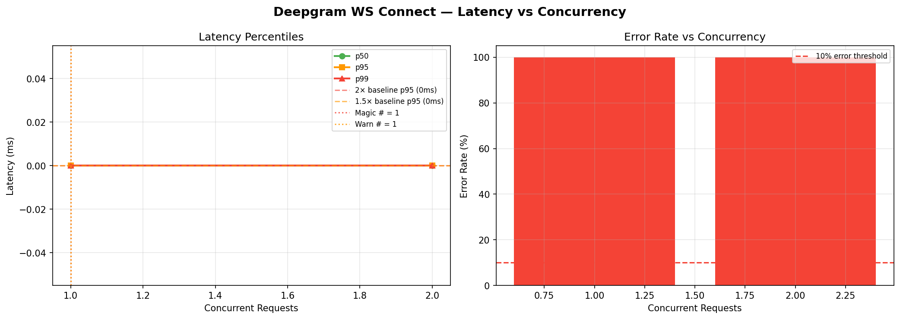

# Deepgram WS Connect — Magic Number Report
**Date:** 2026-06-17 08:45 UTC

## 🎯 Magic Number: `1`

| Finding | Value |
|---------|-------|
| **Safe limit (magic #)** | **1 concurrent** |
| Warn limit | 1 concurrent |
| Baseline p95 | 0 ms |
| Degradation threshold | >0 ms (2× baseline) |

> **Recommendation:** Keep concurrent Deepgram WS Connect calls ≤ **1**.
> Above 1, latency starts climbing. Above 1, p95 doubles.



## Ladder Results

|   n | p50   | p90   | p95   | p99   | max   | ok%   | status   |
|-----|-------|-------|-------|-------|-------|-------|----------|
|   1 | 0.0ms | 0.0ms | 0.0ms | 0.0ms | 0.0ms | 0.0%  | 🟢 OK    |
|   2 | 0.0ms | 0.0ms | 0.0ms | 0.0ms | 0.0ms | 0.0%  | 🟢 OK    |

## ASCII Latency Chart

```
   n                 p95 latency                  ms
------------------------------------------------------------
   1                                                   0  ← MAGIC
   2                                                   0  
```

## Interpretation

- 🟢 **OK**: p95 within 1.5× baseline — full speed ahead
- 🟡 **WARN**: p95 between 1.5× and 2× baseline — approaching limit
- 🔴 **DEGRADED**: p95 > 2× baseline — throttle here


## Operational Recommendation

```python
# In your KeyManager / interview orchestrator:
MAX_CONCURRENT_DEEPGRAM = 1   # magic number — do not exceed
WARN_CONCURRENT_DEEPGRAM = 1    # start queuing above this

# If you have multiple API keys (key_a, key_b, key_c),
# each key can carry 1 streams:
# Total safe capacity = num_keys × 1
```

## What happens above the magic number

Above **1** concurrent streams:
- p95 latency jumps from ~0ms to >0ms
- Candidates start noticing transcript delays
- Bot responses slow down
- At high enough concurrency, Deepgram returns HTTP 429


---
*Report: `deepgram_ws_connect_20260617_084526.md`*
