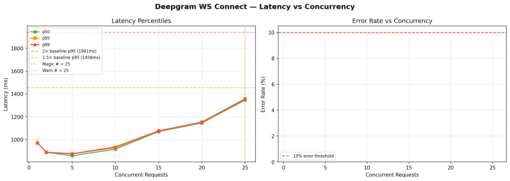

# Deepgram WS Connect — Magic Number Report
**Date:** 2026-06-17 08:46 UTC

## 🎯 Magic Number: `25`

| Finding | Value |
|---------|-------|
| **Safe limit (magic #)** | **25 concurrent** |
| Warn limit | 25 concurrent |
| Baseline p95 | 970 ms |
| Degradation threshold | >1941 ms (2× baseline) |

> **Recommendation:** Keep concurrent Deepgram WS Connect calls ≤ **25**.
> Above 25, latency starts climbing. Above 25, p95 doubles.



## Ladder Results

|   n | p50      | p90      | p95      | p99      | max      | ok%    | status   |
|-----|----------|----------|----------|----------|----------|--------|----------|
|   1 | 970.3ms  | 970.3ms  | 970.3ms  | 970.3ms  | 970.3ms  | 100.0% | 🟢 OK    |
|   2 | 888.6ms  | 888.9ms  | 888.9ms  | 889.0ms  | 889.0ms  | 100.0% | 🟢 OK    |
|   5 | 857.8ms  | 873.7ms  | 874.5ms  | 875.2ms  | 875.3ms  | 100.0% | 🟢 OK    |
|  10 | 915.9ms  | 922.0ms  | 929.2ms  | 935.1ms  | 936.5ms  | 100.0% | 🟢 OK    |
|  15 | 1070.2ms | 1075.5ms | 1075.6ms | 1075.7ms | 1075.7ms | 100.0% | 🟢 OK    |
|  20 | 1145.5ms | 1151.1ms | 1151.3ms | 1153.0ms | 1153.4ms | 100.0% | 🟢 OK    |
|  25 | 1345.5ms | 1354.9ms | 1355.5ms | 1356.3ms | 1356.6ms | 100.0% | 🟢 OK    |

## ASCII Latency Chart

```
   n                 p95 latency                  ms
------------------------------------------------------------
   1  ████████████████████████████                   970  
   2  ██████████████████████████                     889  
   5  █████████████████████████                      875  
  10  ███████████████████████████                    929  
  15  ███████████████████████████████               1076  
  20  █████████████████████████████████             1151  
  25  ████████████████████████████████████████      1355  ← MAGIC
```

## Interpretation

- 🟢 **OK**: p95 within 1.5× baseline — full speed ahead
- 🟡 **WARN**: p95 between 1.5× and 2× baseline — approaching limit
- 🔴 **DEGRADED**: p95 > 2× baseline — throttle here


## Operational Recommendation

```python
# In your KeyManager / interview orchestrator:
MAX_CONCURRENT_DEEPGRAM = 25   # magic number — do not exceed
WARN_CONCURRENT_DEEPGRAM = 25    # start queuing above this

# If you have multiple API keys (key_a, key_b, key_c),
# each key can carry 25 streams:
# Total safe capacity = num_keys × 25
```

## What happens above the magic number

Above **25** concurrent streams:
- p95 latency jumps from ~970ms to >1941ms
- Candidates start noticing transcript delays
- Bot responses slow down
- At high enough concurrency, Deepgram returns HTTP 429


---
*Report: `deepgram_ws_connect_20260617_084635.md`*
