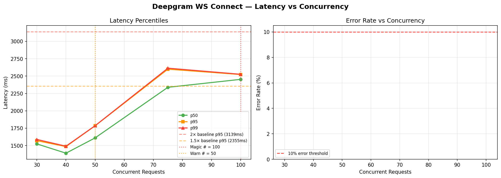

# Deepgram WS Connect — Magic Number Report
**Date:** 2026-06-17 08:53 UTC

## 🎯 Magic Number: `100`

| Finding | Value |
|---------|-------|
| **Safe limit (magic #)** | **100 concurrent** |
| Warn limit | 50 concurrent |
| Baseline p95 | 1570 ms |
| Degradation threshold | >3139 ms (2× baseline) |

> **Recommendation:** Keep concurrent Deepgram WS Connect calls ≤ **100**.
> Above 50, latency starts climbing. Above 100, p95 doubles.



## Ladder Results

|   n | p50      | p90      | p95      | p99      | max      | ok%    | status   |
|-----|----------|----------|----------|----------|----------|--------|----------|
|  30 | 1523.4ms | 1566.6ms | 1569.7ms | 1587.5ms | 1594.1ms | 100.0% | 🟢 OK    |
|  40 | 1389.8ms | 1455.1ms | 1484.9ms | 1490.5ms | 1491.5ms | 100.0% | 🟢 OK    |
|  50 | 1610.0ms | 1702.6ms | 1784.1ms | 1785.4ms | 1786.0ms | 100.0% | 🟢 OK    |
|  75 | 2338.5ms | 2573.5ms | 2599.7ms | 2614.1ms | 2614.8ms | 100.0% | 🟡 WARM  |
| 100 | 2453.1ms | 2518.5ms | 2522.3ms | 2526.2ms | 2526.7ms | 100.0% | 🟡 WARM  |

## ASCII Latency Chart

```
   n                 p95 latency                  ms
------------------------------------------------------------
  30  ████████████████████████                      1570  
  40  ██████████████████████                        1485  
  50  ███████████████████████████                   1784  ← WARN
  75  ████████████████████████████████████████      2600  
 100  ██████████████████████████████████████        2522  ← MAGIC
```

## Interpretation

- 🟢 **OK**: p95 within 1.5× baseline — full speed ahead
- 🟡 **WARN**: p95 between 1.5× and 2× baseline — approaching limit
- 🔴 **DEGRADED**: p95 > 2× baseline — throttle here


## Operational Recommendation

```python
# In your KeyManager / interview orchestrator:
MAX_CONCURRENT_DEEPGRAM = 100   # magic number — do not exceed
WARN_CONCURRENT_DEEPGRAM = 50    # start queuing above this

# If you have multiple API keys (key_a, key_b, key_c),
# each key can carry 100 streams:
# Total safe capacity = num_keys × 100
```

## What happens above the magic number

Above **100** concurrent streams:
- p95 latency jumps from ~1570ms to >3139ms
- Candidates start noticing transcript delays
- Bot responses slow down
- At high enough concurrency, Deepgram returns HTTP 429


---
*Report: `deepgram_ws_connect_20260617_085345.md`*
