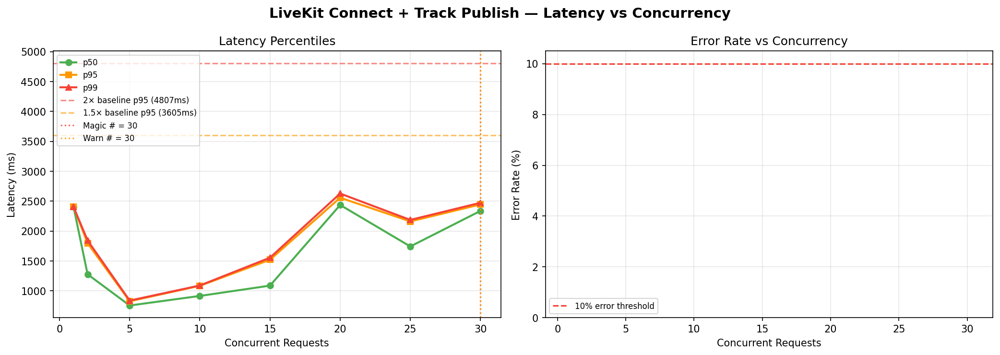

# LiveKit Connect + Track Publish — Magic Number Report
**Date:** 2026-06-17 08:48 UTC

## 🎯 Magic Number: `30`

| Finding | Value |
|---------|-------|
| **Safe limit (magic #)** | **30 concurrent** |
| Warn limit | 30 concurrent |
| Baseline p95 | 2404 ms |
| Degradation threshold | >4807 ms (2× baseline) |

> **Recommendation:** Keep concurrent LiveKit Connect + Track Publish calls ≤ **30**.
> Above 30, latency starts climbing. Above 30, p95 doubles.



## Ladder Results

|   n | p50      | p90      | p95      | p99      | max      | ok%    | status   |
|-----|----------|----------|----------|----------|----------|--------|----------|
|   1 | 2403.7ms | 2403.7ms | 2403.7ms | 2403.7ms | 2403.7ms | 100.0% | 🟢 OK    |
|   2 | 1278.5ms | 1739.8ms | 1797.5ms | 1843.7ms | 1855.2ms | 100.0% | 🟢 OK    |
|   5 | 756.8ms  | 814.2ms  | 828.0ms  | 839.1ms  | 841.9ms  | 100.0% | 🟢 OK    |
|  10 | 916.9ms  | 1080.3ms | 1086.3ms | 1091.0ms | 1092.2ms | 100.0% | 🟢 OK    |
|  15 | 1089.1ms | 1465.8ms | 1521.8ms | 1556.2ms | 1564.8ms | 100.0% | 🟢 OK    |
|  20 | 2437.6ms | 2539.9ms | 2558.9ms | 2628.5ms | 2645.9ms | 100.0% | 🟢 OK    |
|  25 | 1743.9ms | 2116.0ms | 2162.6ms | 2187.6ms | 2191.9ms | 100.0% | 🟢 OK    |
|  30 | 2338.0ms | 2394.7ms | 2446.2ms | 2474.0ms | 2476.6ms | 100.0% | 🟢 OK    |

## ASCII Latency Chart

```
   n                 p95 latency                  ms
------------------------------------------------------------
   1  █████████████████████████████████████         2404  
   2  ████████████████████████████                  1798  
   5  ████████████                                   828  
  10  ████████████████                              1086  
  15  ███████████████████████                       1522  
  20  ████████████████████████████████████████      2559  
  25  █████████████████████████████████             2163  
  30  ██████████████████████████████████████        2446  ← MAGIC
```

## Interpretation

- 🟢 **OK**: p95 within 1.5× baseline — full speed ahead
- 🟡 **WARN**: p95 between 1.5× and 2× baseline — approaching limit
- 🔴 **DEGRADED**: p95 > 2× baseline — throttle here


## Operational Recommendation

```python
# In your orchestration / key manager:
MAX_CONCURRENT_LIVEKIT_ROOMS = 30

# LiveKit Cloud handles the SFU scaling automatically,
# but your bot participants (Python) are the bottleneck —
# each bot opens: 1 Room, 1 AudioSource, 1-2 async tasks.
# Monitor asyncio task count: len(asyncio.all_tasks())
```

## What LiveKit Bottlenecks Look Like

| Symptom | Cause | Fix |
|---------|-------|-----|
| connect p95 > 3s | SFU cold room | Pre-warm rooms before interviews |
| publish fails | DTLS timeout | Retry with backoff |
| audio drop mid-interview | SFU packet loss | Use LiveKit Cloud (managed) |
| n=50 all green, n=100 degraded | Bot Python event loop lag | Use multiprocess per interview |

## SFU vs Bot Process Limits

LiveKit Cloud SFU can handle hundreds of rooms.
YOUR BOTTLENECK is the Python bot process:
- Each interview needs ~2-4 async tasks
- 50 interviews = 100-200 tasks in one event loop
- Monitor with: `len(asyncio.all_tasks())`
- Degrade point estimated at ~90 interviews per Python process


---
*Report: `livekit_connect_+_track_publish_20260617_084906.md`*
