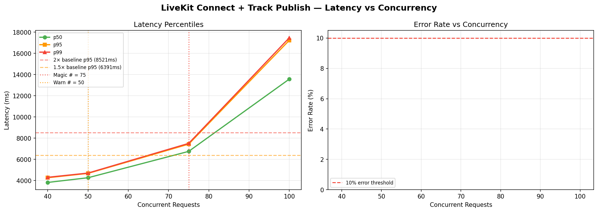

# LiveKit Connect + Track Publish — Magic Number Report
**Date:** 2026-06-17 08:53 UTC

## 🎯 Magic Number: `75`

| Finding | Value |
|---------|-------|
| **Safe limit (magic #)** | **75 concurrent** |
| Warn limit | 50 concurrent |
| Baseline p95 | 4261 ms |
| Degradation threshold | >8521 ms (2× baseline) |

> **Recommendation:** Keep concurrent LiveKit Connect + Track Publish calls ≤ **75**.
> Above 50, latency starts climbing. Above 75, p95 doubles.



## Ladder Results

|   n | p50       | p90       | p95       | p99       | max       | ok%    | status      |
|-----|-----------|-----------|-----------|-----------|-----------|--------|-------------|
|  40 | 3816.3ms  | 4237.8ms  | 4260.6ms  | 4303.2ms  | 4305.6ms  | 100.0% | 🟢 OK       |
|  50 | 4260.7ms  | 4572.7ms  | 4671.0ms  | 4702.4ms  | 4711.5ms  | 100.0% | 🟢 OK       |
|  75 | 6749.1ms  | 7409.8ms  | 7431.4ms  | 7504.5ms  | 7513.9ms  | 100.0% | 🟡 WARM     |
| 100 | 13576.4ms | 17022.0ms | 17239.0ms | 17477.4ms | 17478.2ms | 100.0% | 🔴 DEGRADED |

## ASCII Latency Chart

```
   n                 p95 latency                  ms
------------------------------------------------------------
  40  █████████                                     4261  
  50  ██████████                                    4671  ← WARN
  75  █████████████████                             7431  ← MAGIC
 100  ████████████████████████████████████████     17239  
```

## Interpretation

- 🟢 **OK**: p95 within 1.5× baseline — full speed ahead
- 🟡 **WARN**: p95 between 1.5× and 2× baseline — approaching limit
- 🔴 **DEGRADED**: p95 > 2× baseline — throttle here


## Operational Recommendation

```python
# In your orchestration / key manager:
MAX_CONCURRENT_LIVEKIT_ROOMS = 75

# LiveKit Cloud handles the SFU scaling automatically,
# but your bot participants (Python) are the bottleneck —
# each bot opens: 1 Room, 1 AudioSource, 1-2 async tasks.
# Monitor asyncio task count: len(asyncio.all_tasks())
```

## What LiveKit Bottlenecks Look Like

| Symptom | Cause | Fix |
|---------|-------|-----|
| connect p95 > 3s | SFU cold room | Pre-warm rooms before interviews |
| publish fails | DTLS timeout | Retry with backoff |
| audio drop mid-interview | SFU packet loss | Use LiveKit Cloud (managed) |
| n=50 all green, n=100 degraded | Bot Python event loop lag | Use multiprocess per interview |

## SFU vs Bot Process Limits

LiveKit Cloud SFU can handle hundreds of rooms.
YOUR BOTTLENECK is the Python bot process:
- Each interview needs ~2-4 async tasks
- 50 interviews = 100-200 tasks in one event loop
- Monitor with: `len(asyncio.all_tasks())`
- Degrade point estimated at ~225 interviews per Python process


---
*Report: `livekit_connect_+_track_publish_20260617_085401.md`*
