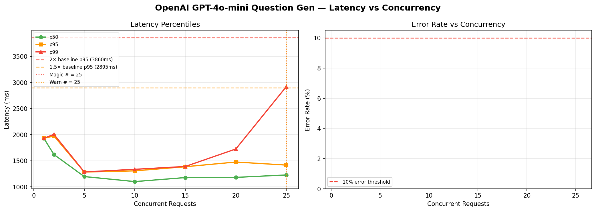

# OpenAI GPT-4o-mini Question Gen — Magic Number Report
**Date:** 2026-06-17 08:43 UTC

## 🎯 Magic Number: `25`

| Finding | Value |
|---------|-------|
| **Safe limit (magic #)** | **25 concurrent** |
| Warn limit | 25 concurrent |
| Baseline p95 | 1930 ms |
| Degradation threshold | >3860 ms (2× baseline) |

> **Recommendation:** Keep concurrent OpenAI GPT-4o-mini Question Gen calls ≤ **25**.
> Above 25, latency starts climbing. Above 25, p95 doubles.



## Ladder Results

|   n | p50      | p90      | p95      | p99      | max      | ok%    | status   |
|-----|----------|----------|----------|----------|----------|--------|----------|
|   1 | 1929.9ms | 1929.9ms | 1929.9ms | 1929.9ms | 1929.9ms | 100.0% | 🟢 OK    |
|   2 | 1618.4ms | 1933.4ms | 1972.8ms | 2004.3ms | 2012.2ms | 100.0% | 🟢 OK    |
|   5 | 1196.4ms | 1281.0ms | 1283.2ms | 1285.0ms | 1285.5ms | 100.0% | 🟢 OK    |
|  10 | 1100.2ms | 1269.4ms | 1305.9ms | 1335.2ms | 1342.5ms | 100.0% | 🟢 OK    |
|  15 | 1177.0ms | 1371.7ms | 1384.7ms | 1389.6ms | 1390.8ms | 100.0% | 🟢 OK    |
|  20 | 1180.6ms | 1354.1ms | 1475.0ms | 1724.9ms | 1787.4ms | 100.0% | 🟢 OK    |
|  25 | 1227.3ms | 1404.9ms | 1416.2ms | 2920.7ms | 3395.3ms | 100.0% | 🟢 OK    |

## ASCII Latency Chart

```
   n                 p95 latency                  ms
------------------------------------------------------------
   1  ███████████████████████████████████████       1930  
   2  ████████████████████████████████████████      1973  
   5  ██████████████████████████                    1283  
  10  ██████████████████████████                    1306  
  15  ████████████████████████████                  1385  
  20  █████████████████████████████                 1475  
  25  ████████████████████████████                  1416  ← MAGIC
```

## Interpretation

- 🟢 **OK**: p95 within 1.5× baseline — full speed ahead
- 🟡 **WARN**: p95 between 1.5× and 2× baseline — approaching limit
- 🔴 **DEGRADED**: p95 > 2× baseline — throttle here


## Operational Recommendation

```python
# In your interview orchestrator:
MAX_CONCURRENT_OPENAI_QGEN = 25

# If you have interview peaks (all 50 candidates answer at once),
# use a semaphore:
openai_sem = asyncio.Semaphore(25)
async with openai_sem:
    result = await openai_call(...)
```

## Rate Limit Notes
- OpenAI TPM (tokens per minute) limits matter as much as RPM
- At n=25, estimated TPM ≈ 24,000 tokens/min
  (assuming ~5s per call, 80 tokens each)
- Check your OpenAI tier limits at platform.openai.com/account/limits


---
*Report: `openai_gpt-4o-mini_question_gen_20260617_084417.md`*
