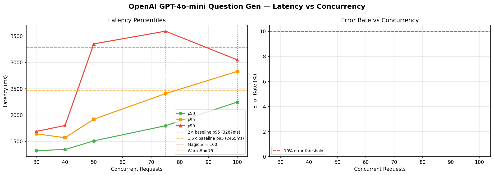

# OpenAI GPT-4o-mini Question Gen — Magic Number Report
**Date:** 2026-06-17 08:53 UTC

## 🎯 Magic Number: `100`

| Finding | Value |
|---------|-------|
| **Safe limit (magic #)** | **100 concurrent** |
| Warn limit | 75 concurrent |
| Baseline p95 | 1644 ms |
| Degradation threshold | >3287 ms (2× baseline) |

> **Recommendation:** Keep concurrent OpenAI GPT-4o-mini Question Gen calls ≤ **100**.
> Above 75, latency starts climbing. Above 100, p95 doubles.



## Ladder Results

|   n | p50      | p90      | p95      | p99      | max      | ok%    | status   |
|-----|----------|----------|----------|----------|----------|--------|----------|
|  30 | 1325.6ms | 1507.3ms | 1643.6ms | 1689.8ms | 1702.1ms | 100.0% | 🟢 OK    |
|  40 | 1345.8ms | 1562.6ms | 1570.6ms | 1802.8ms | 1894.2ms | 100.0% | 🟢 OK    |
|  50 | 1510.5ms | 1873.3ms | 1921.1ms | 3350.9ms | 3850.6ms | 100.0% | 🟢 OK    |
|  75 | 1797.9ms | 2300.7ms | 2407.1ms | 3592.7ms | 3817.4ms | 100.0% | 🟢 OK    |
| 100 | 2247.2ms | 2754.4ms | 2829.4ms | 3047.7ms | 7665.3ms | 100.0% | 🟡 WARM  |

## ASCII Latency Chart

```
   n                 p95 latency                  ms
------------------------------------------------------------
  30  ███████████████████████                       1644  
  40  ██████████████████████                        1571  
  50  ███████████████████████████                   1921  
  75  ██████████████████████████████████            2407  ← WARN
 100  ████████████████████████████████████████      2829  ← MAGIC
```

## Interpretation

- 🟢 **OK**: p95 within 1.5× baseline — full speed ahead
- 🟡 **WARN**: p95 between 1.5× and 2× baseline — approaching limit
- 🔴 **DEGRADED**: p95 > 2× baseline — throttle here


## Operational Recommendation

```python
# In your interview orchestrator:
MAX_CONCURRENT_OPENAI_QGEN = 100

# If you have interview peaks (all 50 candidates answer at once),
# use a semaphore:
openai_sem = asyncio.Semaphore(100)
async with openai_sem:
    result = await openai_call(...)
```

## Rate Limit Notes
- OpenAI TPM (tokens per minute) limits matter as much as RPM
- At n=100, estimated TPM ≈ 96,000 tokens/min
  (assuming ~5s per call, 80 tokens each)
- Check your OpenAI tier limits at platform.openai.com/account/limits


---
*Report: `openai_gpt-4o-mini_question_gen_20260617_085407.md`*
