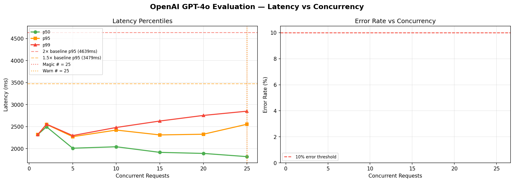

# OpenAI GPT-4o Evaluation — Magic Number Report
**Date:** 2026-06-17 08:45 UTC

## 🎯 Magic Number: `25`

| Finding | Value |
|---------|-------|
| **Safe limit (magic #)** | **25 concurrent** |
| Warn limit | 25 concurrent |
| Baseline p95 | 2319 ms |
| Degradation threshold | >4639 ms (2× baseline) |

> **Recommendation:** Keep concurrent OpenAI GPT-4o Evaluation calls ≤ **25**.
> Above 25, latency starts climbing. Above 25, p95 doubles.



## Ladder Results

|   n | p50      | p90      | p95      | p99      | max      | ok%    | status   |
|-----|----------|----------|----------|----------|----------|--------|----------|
|   1 | 2319.4ms | 2319.4ms | 2319.4ms | 2319.4ms | 2319.4ms | 100.0% | 🟢 OK    |
|   2 | 2495.9ms | 2545.4ms | 2551.6ms | 2556.5ms | 2557.7ms | 100.0% | 🟢 OK    |
|   5 | 2010.5ms | 2241.3ms | 2272.5ms | 2297.3ms | 2303.6ms | 100.0% | 🟢 OK    |
|  10 | 2043.2ms | 2348.8ms | 2422.3ms | 2481.1ms | 2495.8ms | 100.0% | 🟢 OK    |
|  15 | 1916.1ms | 2142.7ms | 2311.9ms | 2627.5ms | 2706.4ms | 100.0% | 🟢 OK    |
|  20 | 1892.1ms | 2173.3ms | 2327.8ms | 2754.6ms | 2861.3ms | 100.0% | 🟢 OK    |
|  25 | 1819.4ms | 2145.5ms | 2554.3ms | 2850.7ms | 2913.0ms | 100.0% | 🟢 OK    |

## ASCII Latency Chart

```
   n                 p95 latency                  ms
------------------------------------------------------------
   1  ████████████████████████████████████          2319  
   2  ███████████████████████████████████████       2552  
   5  ███████████████████████████████████           2272  
  10  █████████████████████████████████████         2422  
  15  ████████████████████████████████████          2312  
  20  ████████████████████████████████████          2328  
  25  ████████████████████████████████████████      2554  ← MAGIC
```

## Interpretation

- 🟢 **OK**: p95 within 1.5× baseline — full speed ahead
- 🟡 **WARN**: p95 between 1.5× and 2× baseline — approaching limit
- 🔴 **DEGRADED**: p95 > 2× baseline — throttle here


## Operational Recommendation

```python
# In your interview orchestrator:
MAX_CONCURRENT_OPENAI_EVAL = 25

# If you have interview peaks (all 50 candidates answer at once),
# use a semaphore:
openai_sem = asyncio.Semaphore(25)
async with openai_sem:
    result = await openai_call(...)
```

## Rate Limit Notes
- OpenAI TPM (tokens per minute) limits matter as much as RPM
- At n=25, estimated TPM ≈ 60,000 tokens/min
  (assuming ~5s per call, 200 tokens each)
- Check your OpenAI tier limits at platform.openai.com/account/limits


---
*Report: `openai_gpt-4o_evaluation_20260617_084538.md`*
