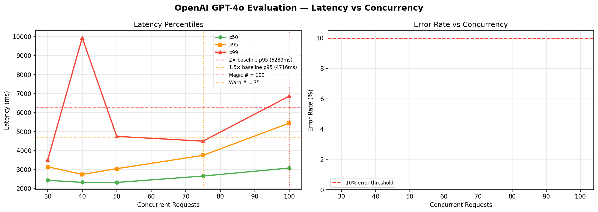

# OpenAI GPT-4o Evaluation — Magic Number Report
**Date:** 2026-06-17 08:53 UTC

## 🎯 Magic Number: `100`

| Finding | Value |
|---------|-------|
| **Safe limit (magic #)** | **100 concurrent** |
| Warn limit | 75 concurrent |
| Baseline p95 | 3144 ms |
| Degradation threshold | >6289 ms (2× baseline) |

> **Recommendation:** Keep concurrent OpenAI GPT-4o Evaluation calls ≤ **100**.
> Above 75, latency starts climbing. Above 100, p95 doubles.



## Ladder Results

|   n | p50      | p90      | p95      | p99      | max       | ok%    | status   |
|-----|----------|----------|----------|----------|-----------|--------|----------|
|  30 | 2430.8ms | 2808.9ms | 3144.3ms | 3500.6ms | 3626.5ms  | 100.0% | 🟢 OK    |
|  40 | 2323.9ms | 2599.3ms | 2741.7ms | 9934.6ms | 14365.0ms | 100.0% | 🟢 OK    |
|  50 | 2318.9ms | 2923.6ms | 3043.6ms | 4742.7ms | 6335.4ms  | 100.0% | 🟢 OK    |
|  75 | 2656.3ms | 3241.3ms | 3744.3ms | 4493.5ms | 4688.1ms  | 100.0% | 🟢 OK    |
| 100 | 3076.5ms | 4178.6ms | 5441.8ms | 6864.6ms | 7069.6ms  | 100.0% | 🟡 WARM  |

## ASCII Latency Chart

```
   n                 p95 latency                  ms
------------------------------------------------------------
  30  ███████████████████████                       3144  
  40  ████████████████████                          2742  
  50  ██████████████████████                        3044  
  75  ███████████████████████████                   3744  ← WARN
 100  ████████████████████████████████████████      5442  ← MAGIC
```

## Interpretation

- 🟢 **OK**: p95 within 1.5× baseline — full speed ahead
- 🟡 **WARN**: p95 between 1.5× and 2× baseline — approaching limit
- 🔴 **DEGRADED**: p95 > 2× baseline — throttle here


## Operational Recommendation

```python
# In your interview orchestrator:
MAX_CONCURRENT_OPENAI_EVAL = 100

# If you have interview peaks (all 50 candidates answer at once),
# use a semaphore:
openai_sem = asyncio.Semaphore(100)
async with openai_sem:
    result = await openai_call(...)
```

## Rate Limit Notes
- OpenAI TPM (tokens per minute) limits matter as much as RPM
- At n=100, estimated TPM ≈ 240,000 tokens/min
  (assuming ~5s per call, 200 tokens each)
- Check your OpenAI tier limits at platform.openai.com/account/limits


---
*Report: `openai_gpt-4o_evaluation_20260617_085408.md`*
